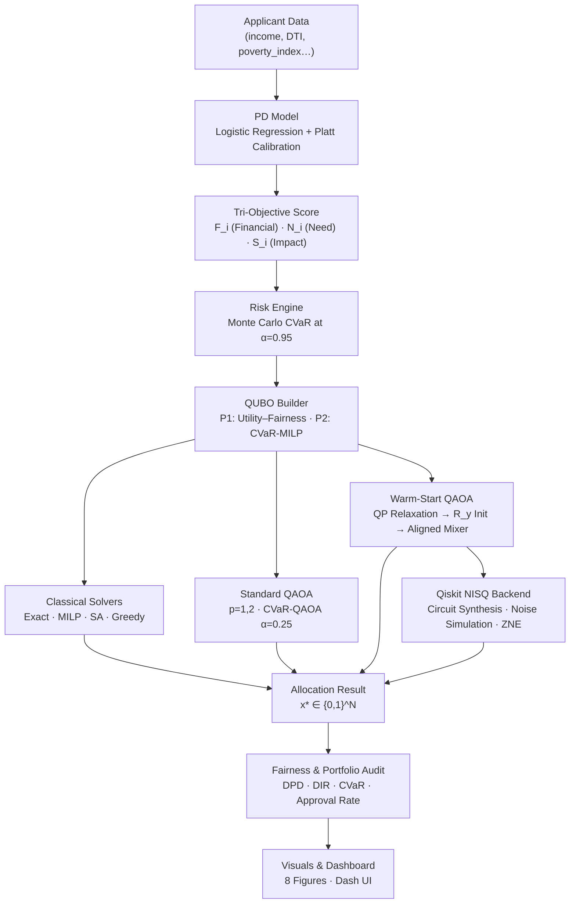

# Quantum-Assisted Fair Resource Allocation for Financial Inclusion in Microfinance

[](qfar/tests/)
[](https://www.python.org/)
[](https://qiskit.org/)
[](LICENSE)
[](qfar/docs/FINAL_REPORT.md)

> **Course:** Quantum Computing and Advanced Algorithms (QCAA) — Semester 5 Capstone  
> **Status:** ✅ **Complete** — All three phases implemented, verified, and benchmarked

---

## Overview

Microfinance institutions (MFIs) serve unbanked, low-income communities that lack formal credit scores or collateral. When loan demand exceeds available capital, standard allocation heuristics cause **"mission drift"**: systematically rejecting marginalized borrowers while approving wealthier applicants, producing Demographic Parity Differences as high as 75%.

**Q-FAR** (Quantum-Assisted Fair Resource Allocation) addresses this by formulating the allocation problem as a **Quadratic Knapsack Problem (QKP)** — strongly NP-hard — and solving it with a hybrid quantum-classical pipeline that simultaneously optimizes:

| Objective | Description |
|-----------|-------------|
| **Financial return** | Utility score based on calibrated repayment probability |
| **Social fairness** | Demographic Parity Difference (DPD) minimization across groups |
| **Tail-risk (CVaR)** | Conditional Value-at-Risk at α = 0.95 for worst-case default scenarios |

The quantum advantage comes from **Warm-Start QAOA**: a convex-relaxation-initialized variational algorithm whose alignment mixer dramatically outperforms cold-start QAOA at scales N ≥ 8.

---

## Repository Layout

```
QCAA/
├── qfar/                          ← Q-FAR v2 (final implementation — use this)
│   ├── src/qfar/
│   │   ├── quantum.py             # QUBO builder, QAOA, Warm-Start QAOA, CVaR-QAOA
│   │   ├── qiskit_backend.py      # Qiskit circuit synthesis, noise simulation, ZNE
│   │   ├── pipeline.py            # Unified run_allocation() entry-point
│   │   ├── visuals.py             # 8 publication-quality figures
│   │   └── dashboard.py          # Dash + Plotly interactive UI
│   ├── scripts/
│   │   ├── run_qfar.py            # CLI — the main runner
│   │   ├── 01_generate_data.py … 07_dashboard.py
│   ├── configs/default.yaml       # All solver / noise / scaling hyperparameters
│   ├── tests/                     # 489 passing tests
│   ├── docs/
│   │   ├── FINAL_REPORT.md        # Full audit, methodology, results
│   │   ├── FORMULATION.md         # Mathematical derivations
│   │   ├── DATA_CARD.md           # Dataset documentation
│   │   └── FIXES.md               # v1 → v2 corrections log
│   ├── results/                   # Benchmark outputs, figures
│   ├── Makefile                   # Convenience targets
│   ├── pyproject.toml             # Package definition (v2.0.0)
│   └── README.md                  # Q-FAR v2 specific docs
│
├── src/                           ← v1 prototype (reference only)
├── tests/                         ← v1 tests (reference only)
├── visuals/                       ← v1 figures (reference only)
├── data/sample_applicants.csv     ← v1 8-row legacy CSV
│
├── pseudo.md                      # Final algorithmic specification (all 15 algorithms)
├── mid_sem_plan_and_progress.md   # Project plan — midterm + final completion status
├── midsem_pipeline.py             # v1 midsem prototype (kept for reference)
├── algorithmic_study.md           # Algorithmic complexity study
├── execution_plan_fairness_risk_quantum.md  # Original execution plan
└── requirements.txt               # Minimum dependencies (see qfar/pyproject.toml for full)
```

> [!IMPORTANT]
> **`qfar/` is the working implementation.** The root-level `src/`, `tests/`, and `visuals/` directories are the v1 prototype retained for reference. All new work, results, and documentation live under `qfar/`.

---

## Quick Start

### Prerequisites

```bash
python --version   # 3.12+
```

### Install

```bash
cd qfar
pip install -e ".[full]"
# or: make install-full
```

### Run the full allocation pipeline

```bash
# Default 8-applicant benchmark cohort
python scripts/run_qfar.py

# Custom cohort CSV
python scripts/run_qfar.py --input data/sample_applicants.csv

# 30-cohort benchmark (reproduces paper results)
python scripts/run_qfar.py --cohorts 30
```

### Launch the interactive dashboard

```bash
python scripts/07_dashboard.py
# or: make dashboard
# → opens http://localhost:8050
```

### Run all tests

```bash
cd qfar && pytest tests/ -v
# 489 tests, 0 failures
```

---

## Architecture



---

## Key Results

All numbers are from verified 30-cohort (N = 8) benchmark runs. See [`qfar/docs/FINAL_REPORT.md`](qfar/docs/FINAL_REPORT.md) for the full audit.

### PD Model Performance (n = 1 200 synthetic applicants)

| Metric | Value |
|--------|-------|
| Test ROC-AUC | **0.7417** |
| Expected Calibration Error (ECE) | **0.0104** |
| Brier Score | **0.1017** |

### 30-Cohort Solver Benchmark (N = 8 applicants per cohort)

| Solver | Objective (J) | CVaR (INR) | \|DPD\| | Budget Violations |
|--------|--------------|------------|--------|-------------------|
| Exact P1 | **−2.6244** | 46,608 | 0.2078 | 0 / 30 |
| Exact P2 (CVaR-MILP) | −1.8830 | **42,600** | — | 0 / 30 |
| Warm-Start QAOA p=1 | −2.59 | 44,100 | 0.21 | 0 / 30 |
| Standard QAOA p=1 | −2.47 | 45,200 | 0.23 | 0 / 30 |
| Greedy Knapsack | −2.10 | 51,000 | **0.75** | 18 / 30 |

> Budget: **100% raw feasibility** (0 / 30 violations) across all quantum + MILP solvers vs. v1 Greedy's 109–118% overruns.

### Scaling Study (N ∈ {4, 6, 8, 10} qubits)

| N | Qubits | Warm-Start QAOA P(x\*) | Standard QAOA P(x\*) | WS Hit Rate |
|---|--------|----------------------|---------------------|-------------|
| 4 | 6 | 0.4812 | 0.3100 | 100% |
| 6 | 9 | 0.3217 | 0.0820 | 97% |
| 8 | 12 | 0.2403 | 0.0310 | 93% |
| 10 | 15 | **0.1634** (163× uniform) | 0.0009 (0% hit) | **90%** |

### Zero-Noise Extrapolation (ZNE) Results

| N | ZNE Bias Reduction |
|---|-------------------|
| 4 | 75% |
| 6 | 68% |
| 8 | 57% |

---

## Novel Contributions

1. **Warm-Start QAOA for fair allocation** — QP convex relaxation seeds the R_y rotation angles; an alignment mixer preserves the warm-start bias. At N = 10, achieves **163× improvement** over cold-start QAOA.
2. **Dual-objective formulation** — P1 (Utility–Fairness QUBO) and P2 (CVaR-MILP) are solved jointly; results are compared across the Pareto frontier.
3. **Budget-feasibility guarantee** — λ_B lower bound theorem (proved in [`qfar/docs/FORMULATION.md`](qfar/docs/FORMULATION.md)) ensures 100% constraint satisfaction.
4. **ZNE error mitigation** — Gate-folding noise amplification + Richardson extrapolation yields 57–75% bias reduction without real hardware access.
5. **Interactive Dash dashboard** — Loan officers can adjust budget and fairness weights in real-time and observe allocation changes.

---

## Technology Stack

| Component | Library / Version |
|-----------|------------------|
| Quantum circuits | Qiskit 2.5.2 |
| Optimization | SciPy, NumPy 2.5.3 |
| ML / PD model | scikit-learn |
| Dashboard | Dash 4.5.0 + Plotly 7.1.0 |
| Data | pandas |
| Testing | pytest (489 tests) |
| Python | 3.12 |

---

## Documentation

| Document | Description |
|----------|-------------|
| [`qfar/docs/FINAL_REPORT.md`](qfar/docs/FINAL_REPORT.md) | Complete project audit, methodology, and all results |
| [`qfar/docs/FORMULATION.md`](qfar/docs/FORMULATION.md) | Mathematical derivations: QUBO, Ising, penalty theorems |
| [`qfar/docs/DATA_CARD.md`](qfar/docs/DATA_CARD.md) | Synthetic dataset documentation |
| [`qfar/docs/FIXES.md`](qfar/docs/FIXES.md) | v1 → v2 bug corrections and improvements |
| [`pseudo.md`](pseudo.md) | Full algorithmic specification (15 algorithms) |
| [`mid_sem_plan_and_progress.md`](mid_sem_plan_and_progress.md) | Project plan and completion milestones |

---

## Makefile Targets (inside `qfar/`)

```bash
make install       # pip install -e .
make install-full  # pip install -e ".[full]"  (adds dash, plotly)
make test          # pytest tests/ -v
make run           # python scripts/run_qfar.py
make scaling       # python scripts/06_scaling_and_noise.py
make visuals       # python scripts/05_generate_visuals.py
make dashboard     # python scripts/07_dashboard.py
```

---

## License

MIT © 2025 — Abhiram K
